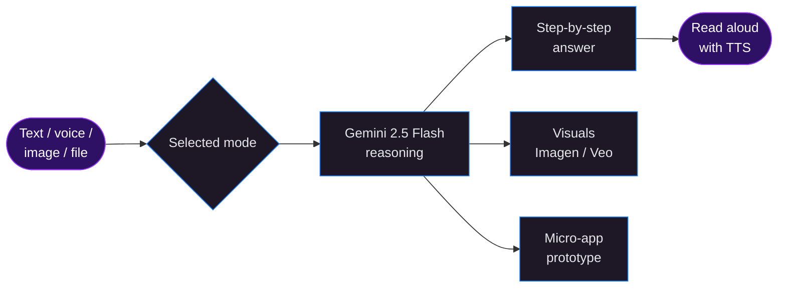

<!-- styled:v2 -->
<div align="center">


**A multimodal Gemini chatbot that turns ideas, images, documents and voice into step-by-step solutions, visual explanations and working micro-app prototypes.**

<p>
  
  
  
  
  
</p>

<p>
  <a href="#overview">Overview</a> ·
  <a href="#how-it-works">How it works</a> ·
  <a href="#features">Features</a> ·
  <a href="#tech-stack">Tech stack</a> ·
  <a href="#project-structure">Project structure</a> ·
  <a href="#getting-started">Getting started</a>
</p>

</div>

---

## Overview

Shah AI accepts text, voice, images, documents or a camera feed, works out the problem and answers with a structured solution, an interactive visual and, in Magic Build mode, a small working app you can try straight away. A calm 3D background and accessibility options keep long sessions comfortable.

## Features

| Mode | What it does |
|:--|:--|
| ✨ **Magic Build** | Builds a functional micro-app prototype from a plain-language idea |
| 🌍 **Global Impact** | Breaks down large real-world problems with diagrams and an action roadmap |
| 🎓 **Educator** | Explains a concept at three levels of difficulty with visual aids |
| ♿ **Accessible** | Voice-first interaction, high-contrast and dyslexia-friendly layout |

- Multimodal input: text, voice, image, document and camera
- Spoken answers with Gemini text-to-speech
- Image generation (Imagen) and short video generation (Veo)
- Insight panel with exportable outputs such as code snippets and scripts
- 3D animated background with soft parallax (Framer Motion)

## How it works



## Tech stack

| Area | Tools |
|:--|:--|
| Frontend | React 19, TypeScript, Vite, Framer Motion |
| AI | Google Gen AI SDK: `gemini-2.5-flash`, `gemini-2.5-flash-preview-tts`, Imagen 3, Veo 3.1 |

## Project structure

```
├── App.tsx
├── components/   # Background3D, ChatArea, InsightPanel, Sidebar
├── services/     # geminiService.ts (chat, TTS, image and video calls)
└── types.ts      # Modes and message types
```

## Getting started

```bash
npm install
echo "GEMINI_API_KEY=your_key" > .env.local
npm run dev
```

---

<div align="center">

**Built by [Ch Muhammad Samiullah](https://github.com/samiullah156-creator)** · AI Automation Engineer and Full-Stack Developer at [Lexvaxa](https://lexvaxa.com)

<a href="https://github.com/samiullah156-creator"></a>
<a href="https://lexvaxa.com/contact"></a>
<a href="https://www.linkedin.com/in/sami-lexvaxa/"></a>

<sub>⭐ Star this repo if you found it useful</sub>

</div>


